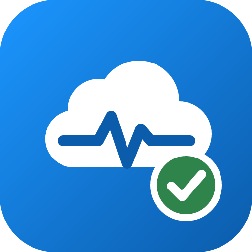

<p align="center"></p>

# SF Org Health Checker

A read-only Salesforce org health checker for Claude Code. Ask Claude "run a health check on my org" and get a scored report covering security, org limits, Apex code, automation, licenses and unused components, with a fix for each finding.

It uses your existing Salesforce CLI login, runs on your computer, and never changes your org.

## What it checks

| Area | Checks |
|---|---|
| Security | Salesforce Health Check score and high/medium-risk settings, users with Modify All Data or View All Data, active users with no login in 90 days, passwords that never expire |
| Org limits | Data and file storage, daily API calls, async Apex, Bulk API, email and every other org limit at 75% or more |
| Apex code | Org-wide and per-class test coverage, classes on old API versions, objects with more than one trigger, inactive triggers, async jobs that failed in the last 7 days |
| Automation | Active Process Builder processes and Workflow Rules (support ended 31 December 2025), inactive flows, objects with many record-triggered flows, paused flow interviews |
| Licenses | Fully used and under-used user licenses, permission set licenses expiring within 60 days, frozen users still holding a license |
| Unused components | Reports not run in a year, unused email templates, unassigned permission sets, custom profiles with no users, queues with no members |

Each area gets a score out of 100 and an A–F grade. A check that the logged-in user has no permission for is listed as "could not run" instead of failing the whole report.

## Requirements

- Claude Desktop, or Claude Code (CLI, desktop app or IDE extension)
- Node.js 20 or later (Claude Code only; Claude Desktop has Node built in)
- Salesforce CLI (`sf`), logged in to the org you want to check

The Salesforce user needs read access to setup data. A System Administrator works. For a least-privilege user, grant View Setup and Configuration, View All Users, and API Enabled.

## Install

Log in to an org first if you have not already:

```sh
sf org login web --alias my-org
# For a sandbox:
sf org login web --alias my-sandbox --instance-url https://test.salesforce.com
```

### Claude Desktop

1. Download `sf-org-health-checker.mcpb` from the [latest release](https://github.com/rajeshyandrathi/sf-org-health-checker/releases/latest).
2. Double-click the file, or drag it into Claude Desktop (Settings → Extensions).
3. Click **Install**. The Salesforce CLI path is optional; leave it blank unless the extension cannot find `sf`.

### Claude Code

```
/plugin marketplace add rajeshyandrathi/sf-org-health-checker
/plugin install sf-org-health-checker@sf-org-health-checker
```

In the VS Code or JetBrains extension, where `/plugin` is not available, run these in a terminal instead:

```sh
claude plugin marketplace add rajeshyandrathi/sf-org-health-checker
claude plugin install sf-org-health-checker@sf-org-health-checker
```

Restart Claude Code (or reload the IDE window).

### Try it

Ask Claude:

- "Run a full health check on my-org"
- "Which users have Modify All Data in my-sandbox?"
- "Do we still have Process Builders or Workflow Rules to migrate?"
- "Are we close to any org limits?"

## Tools

| Tool | Description |
|---|---|
| `list_orgs` | Orgs the Salesforce CLI is logged in to |
| `full_health_check` | All areas, or a chosen subset with `categories` |
| `check_security`, `check_limits`, `check_code`, `check_automation`, `check_licenses`, `check_unused` | One area each |

Every tool takes an optional `org` (alias or username). Without it, the CLI's default org is used.

## Read-only by design

The server only sends HTTP GET requests (SOQL queries and the `/limits` endpoint). It has no code path that creates, updates or deletes records or metadata. Access tokens come from `sf org auth show-access-token`, stay in memory, and are sent only to your org's own instance URL. See [PRIVACY.md](PRIVACY.md).

## Troubleshooting

- **"Salesforce CLI (sf) was not found"**: install the CLI, or set `SF_CLI_PATH` to the full path of the `sf` binary.
- **"Could not connect to …"**: log in again with `sf org login web --alias <alias>`.
- **Apex coverage shows 0%**: coverage comes from the last test run. Run `sf apex run test --test-level RunLocalTests --target-org <alias>` and check again.
- **"Checks that could not run"**: the logged-in user is missing a permission for that query. The message says which one failed.

## Development

```sh
npm install
npm run typecheck
npm run build                          # bundles src/ into plugin/server/index.cjs and extension/server/index.cjs
npm run pack                           # builds dist/sf-org-health-checker.mcpb for Claude Desktop
npm run smoke -- full_health_check my-org   # call a tool through a real MCP client
claude --plugin-dir ./plugin           # try the plugin in Claude Code
claude plugin validate ./plugin
```

The bundled `plugin/server/index.cjs` is committed so the plugin works without an `npm install` on the user's machine. Rebuild it after every source change.

```
src/
  index.ts          MCP server and tool definitions
  salesforce.ts     Read-only REST client using the sf CLI login
  report.ts         Findings, scoring and Markdown report
  checks/           One file per area
plugin/
  .claude-plugin/plugin.json
  .mcp.json         Starts the bundled server
  skills/org-health-check/SKILL.md
  server/index.cjs  Build output
extension/manifest.json   Claude Desktop extension manifest
assets/icon.svg           Icon source (icon.png is rendered from it)
.claude-plugin/marketplace.json
```

## License

MIT © Rajesh Yandrathi
